# stance

**Display settings for Hyprland that can't strand you on a black screen.**
Every change reverts on its own unless you confirm it, even if your bar
crashes. Change refresh rate, resolution, scale, position or layout from the
bar in two clicks, drag screens on a map, and switch between your own
**modes** (gaming, work, single screen…) – from the bar, a hotplug rule, the
laptop lid, the charger, or your phone.

[Türkçe](README.tr.md)

<p align="center">
  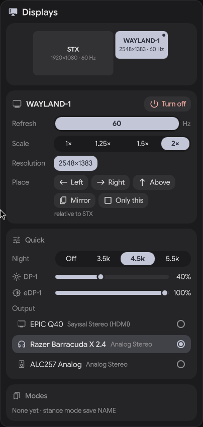
  &nbsp;
  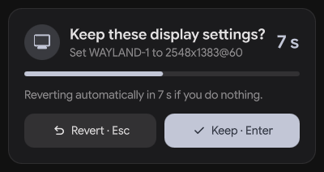
</p>

## Why

Most display tools are "open an app, change, close" or background profile
switchers. stance is built for the bar:

- **Two clicks from the bar** – a small popup with a live layout map.
- **Confirm or revert** – a 12 s countdown on every screen; do nothing and the
  previous setup comes back. Works even if the bar itself dies (a detached
  guardian process owns the timer).
- **Modes beyond monitors** – a mode can also bind workspaces to screens,
  toggle animations / blur / tearing, set gaps and switch the power profile.
  Strictly whitelisted: mode files cannot run commands.
- **Quick controls** – night light (hyprsunset), brightness (laptop
  backlight and external screens over DDC/CI) and audio output in the same
  popup, and in modes.
- **Hotplug rules** (optional daemon) – plug in the dock, get your desk mode.
- **Zero idle cost** – the CLI runs per click and exits (~1 ms, ~1.5 MB
  binary); the optional daemon blocks on Hyprland's event socket (~3 MB RSS).

## Support

| | Status |
|---|---|
| Hyprland | 0.55, 0.56, 0.57 (Lua config and hyprlang). Newer versions: reading works, changing screens needs `--force-version` until tested |
| Bars / shells | end4 / illogical-impulse (built-in button + clipboard shelf), any bar through the standalone panel (`stance setup`), Waybar module |
| Quickshell | 0.2.x |
| Phone | Android 8+ ([stance-deck-android](https://github.com/H0dg4m/stance-deck-android)) |
| Other desktops (KDE, GNOME, Windows) | planned after 1.0 |

stance is alpha. Something not working? See [docs/troubleshooting.md](docs/troubleshooting.md)
(one entry per `stance doctor` message). Reporting a bug: run
`stance doctor --report` and paste the block.

## Install

Arch: `stance-hypr` / `stance-hypr-git` (PKGBUILDs in `packaging/aur`; AUR upload pending). Nix: `nix run github:H0dg4m/stance-hypr`. Every release has a static tarball. All the ways, optional tools and uninstalling: [docs/install.md](docs/install.md). From source:

```sh
cargo build --release
install -Dm755 target/release/stance ~/.local/bin/stance
stance doctor
```

Requires Hyprland **0.55+** with a Lua config (0.57 is tested; 0.57 removed
hyprlang `.conf` support). Legacy `.conf` support for 0.55/0.56 exists but is
experimental. On a Hyprland newer than the tested versions, commands that
change screens refuse to run until stance is updated, unless you pass
`--force-version` (`STANCE_FORCE_VERSION=1` for the services).

## Bar integration

- **Quickshell** (end-4 / illogical-impulse and forks, or your own shell):
  drop-in components – see [docs/quickshell.md](docs/quickshell.md).
- **Waybar**: `stance waybar` prints a status line (mode, screens, a
  "keep?" countdown); see [contrib/waybar](contrib/waybar) for the module
  and click actions. The popup comes from the bundled standalone shell.
- **Any other bar**: run the bundled standalone shell once, then bind a
  click to `qs -p /usr/share/stance/quickshell ipc call stance toggle`.
- **No bar**: everything works from the CLI.

## CLI

```
stance monitors                       list monitors
stance set DP-1 --hz 165              change one monitor
stance set eDP-1 --off                (refuses to turn off the last screen)
stance layout right-of eDP-1 DP-1     left-of | right-of | above | below | mirror | single
stance arrange DP-1=0x0 eDP-1=2560x360  move several screens at once
stance confirm | stance revert        keep / undo the pending change
stance persist                        write ~/.config/hypr/stance-monitors.lua
stance mode save work                 snapshot the current setup as a mode
                                      (--with-quick: also night light + audio output)
stance mode apply gaming
stance mode put work --data '{…}'     write a mode from JSON (what the panel editor uses)
stance rules | stance rules put --data '{…}'   hotplug rules as JSON
stance night on 4500 | off | toggle   night light via hyprsunset
stance brightness DP-1 +10            N | +N | -N percent (DDC/CI or backlight)
stance audio set "Razer"              default output: id, node name or unique text
stance quick                          night light, brightness and audio at once
stance daemon                         hotplug rules (systemd unit in contrib/)
stance doctor                         read-only environment check
```

`<monitor>` can be the description (`"JDR EPIC Q40"`), `"make model"` or the
connector. Changes revert after 12 s unless confirmed (`--timeout S`,
`--no-confirm` for scripts). Every command speaks JSON with `--json`.

### Modes

`~/.config/stance/modes/<name>.toml`:

```toml
description = "External only, effects off"
power_profile = "performance"           # power-saver | balanced | performance
workspaces = { "1-5" = "JDR EPIC Q40" }
night_light = false                     # true | false | temperature in K
audio_sink = "Razer"                    # default audio output

[brightness]                            # monitor match = percent
"JDR EPIC Q40" = 80

[hyprland]                              # whitelist: animations, blur, allow_tearing, gaps_in, gaps_out
animations = false
blur = false
allow_tearing = true

[[monitor]]
match = "JDR EPIC Q40"
mode = "2560x1440@180"
position = "0x0"
vrr = 1

[[monitor]]
match = "AU Optronics 0x7EAD"
enabled = false
```

Monitors a mode names but that are not connected are skipped, so one mode
works docked and undocked. Night light, audio and brightness are applied
after the display change and are not part of the 12 s revert (they cannot
black out a screen); if one fails (headset unplugged, no DDC/CI) the mode
still applies and you get a note. Like the Hyprland options and the power
profile they are "extras": `--no-extras` skips them. More in [`examples/`](examples).

### Hotplug rules

`~/.config/stance/rules.toml` – a rule fires when the connected set equals its
list exactly; nothing matches → nothing happens.

```toml
[[rule]]
monitors = ["AU Optronics 0x7EAD", "JDR EPIC Q40"]
mode = "desk"
allow_extras = false   # true: also apply the mode's Hyprland options, power profile,
                       # night light, audio and brightness (the last three only when
                       # the rule actually changed the screens)
```

Enable with `systemctl --user enable --now stance.service`.

### Phone deck

Turn a phone into a Stream Deck–style remote for stance: buttons for modes,
night light, brightness, audio output and layouts, with Keep / Revert for
display changes. The Android app lives in its own repository,
[stance-deck-android](https://github.com/H0dg4m/stance-deck-android) (Kotlin,
Compose; QR scan with ZXing, no Google services; several PCs; the device key
is wrapped by the Android Keystore). Build it from source or install the APK
from the release page.

<p align="center">
  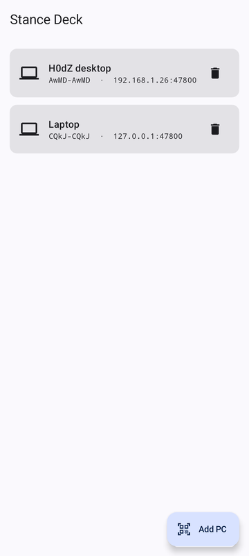
  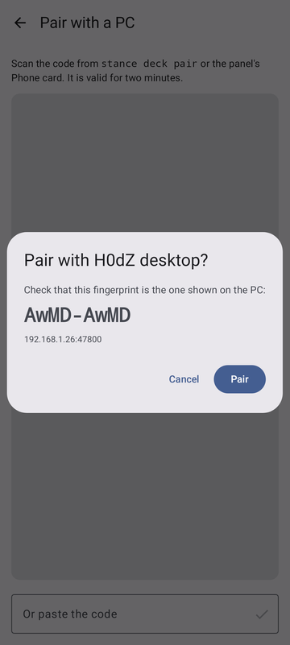
  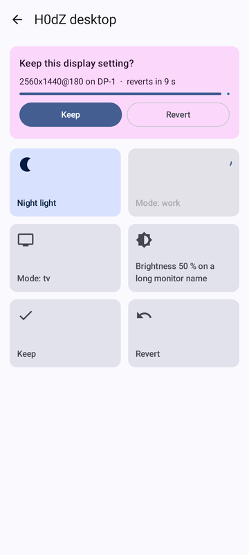
</p>

```sh
stance deck serve            # or: systemctl --user enable --now stance-deck.service
stance deck pair             # QR for the app (one phone, 120 s)
stance deck devices          # paired phones; stance deck unpair NAME
```

1. Open the app, tap **Add PC**, scan the code (or paste it), compare the
   fingerprint with the one the PC shows, tap **Pair**. The PC sends a
   desktop notification when a phone has paired.
2. Press a button. A display change shows **Keep / Revert** on the phone; if
   nobody answers it reverts on its own, like on the PC.

Wi-Fi with QR pairing, or USB with `stance deck serve --loopback` and
`adb reverse tcp:47800 tcp:47800` (then pair with a code whose address is
`127.0.0.1`). Everything is encrypted (Noise), only paired phones get in, and
buttons can only run the actions listed in `~/.config/stance/deck.toml` –
there is no "run a command" button. If you use a firewall, allow TCP 47800
from your LAN (`stance doctor` tells you).

Edit the buttons in the panel (Settings → Phone buttons) or with
`stance deck buttons`, `stance deck put --data JSON`, `stance deck reset`.

<p align="center">
  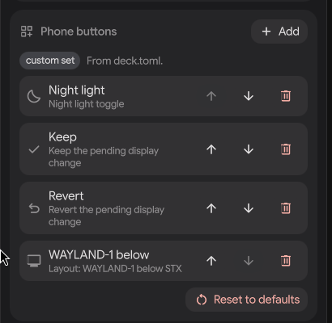
</p>

Details and the wire protocol: [docs/deck.md](docs/deck.md),
[docs/protocol.md](docs/protocol.md); app build and tests:
[stance-deck-android](https://github.com/H0dg4m/stance-deck-android).

### Screens remember their place

stance keeps the last position, mode and scale of every screen it has seen
(`~/.local/state/stance/memory.json`). Turning a screen off and on puts it
back there; with the daemon running, so does unplugging and re-plugging it
when no hotplug rule matches. Use `stance persist` to make a layout survive
Hyprland restarts.

### Laptop lid and power

```lua
-- hyprland.lua: lid closed → laptop panel off (only if another screen is on),
-- lid open → back where it was. No confirm timer: nobody can see one.
hl.bind("switch:on:Lid Switch", hl.dsp.exec_cmd("stance lid close"), { locked = true })
hl.bind("switch:off:Lid Switch", hl.dsp.exec_cmd("stance lid open"), { locked = true })
```

Hotplug rules can depend on the power source; with the daemon running,
plugging the charger in or out re-checks them (`stance power` shows the
current source and the rule that applies):

```toml
[[rule]]
monitors = ["AU Optronics 0x7EAD"]
mode = "battery-saver"
on_power = "battery"     # ac | battery; a matching one wins over a rule without
```

### Persisting

Runtime changes are temporary on purpose (a projector should not stick). Run
`stance persist` to write `stance-monitors.lua` next to your config and add
`require("stance-monitors")` once – after nwg-displays' `require("monitors")`
if you use it. stance never edits your main config.

### Quick controls

- **Night light** talks to hyprsunset's socket. If yours is already running
  (e.g. from your Hyprland config) stance uses it and keeps your gamma; "off"
  is the neutral 6000 K, not a reset. If none runs, `stance night on` starts one.
- **Brightness**: laptop panels through `/sys/class/backlight` and
  `brightnessctl`; external screens through `ddcutil` (needs the `i2c-dev`
  module and access to `/dev/i2c-*`, usually the `i2c` group). Values below
  5 % (backlight) or 1 % (DDC) are raised so a screen cannot go fully dark.
- **Audio output** reads `pw-dump` and switches with `wpctl set-default`.

`stance doctor` reports which of these are available.

## Themes and features

The panel ships 17 themes (Catppuccin, Nord, Gruvbox, Dracula, Tokyo Night,
Rosé Pine, Everforest, Kanagawa, One Dark, Solarized, Stance dark/light) and a
detailed editor; themes are plain JSON files you can export and share.
The panel speaks English and Turkish.

<p align="center">
  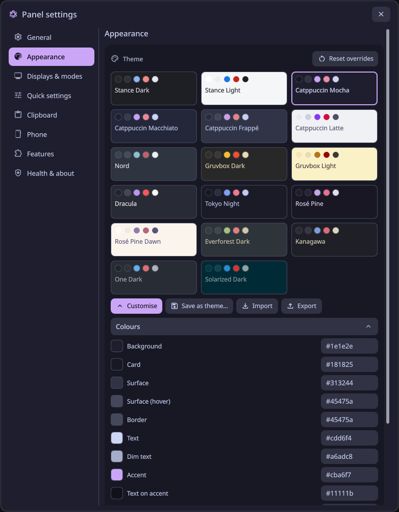
  &nbsp;
  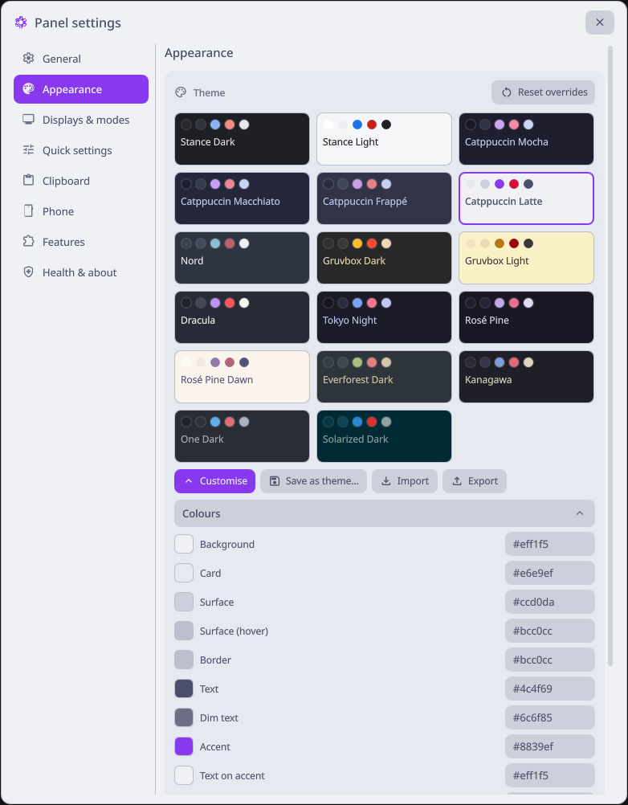
</p>
<p align="center">
  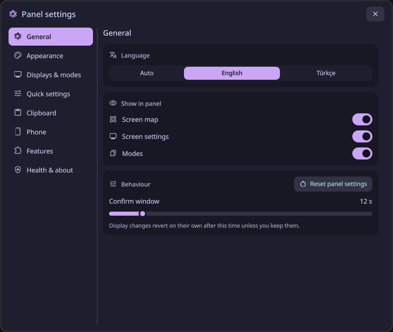
  &nbsp;
  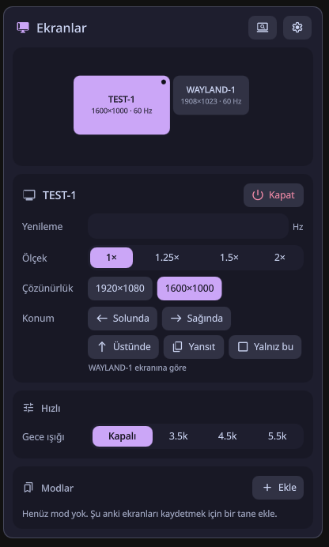
</p>

```sh
stance theme list
stance theme export catppuccin-mocha --out ~/mocha.json
stance theme import ~/friend-theme.json
stance feature off clip          # also: deck, rules, quick
```
Format and rules: [docs/themes.md](docs/themes.md).

## Clipboard shelf

`stance clip` keeps what you copy on three shelves (images, texts, links) and
lets you pick it back from the keyboard. It is off until you enable it, and it
runs next to cliphist without touching it.

```sh
stance clip config put --data '{"enabled":true,"retention_days":30}'
systemctl --user enable --now stance-clip-text stance-clip-image
stance clip list                 # newest first, pinned on top
stance clip copy 12              # back onto the clipboard
stance clip pin 12 ; stance clip rm 13 ; stance clip undo
```

Copies that a password manager marks as sensitive are never stored (cliphist,
if you run it, still stores them). The store is private to your user but not
encrypted. Details: [docs/clip.md](docs/clip.md).

<p align="center">
  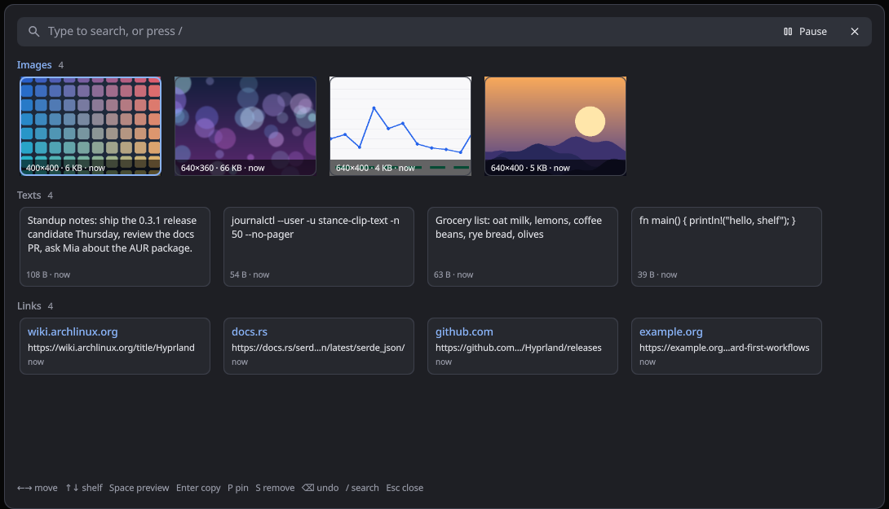
</p>

Open it with `qs -p /usr/share/stance/quickshell ipc call stance clip` (bind it
to a key; see [docs/quickshell.md](docs/quickshell.md)). Arrows move, Space
previews, Enter copies, P pins, S removes, `/` searches.

## Security

- Talks to Hyprland's socket directly; no `hyprctl`, no shell, ever.
- External tools (`ddcutil`, `brightnessctl`, `wpctl`, `pw-dump`,
  `powerprofilesctl`, `hyprsunset`) run by absolute path with an argument
  list, a hard timeout and no stdin; their output is parsed, never executed.
  Brightness targets and audio sinks are resolved against the live device
  list first, so a mode file can only pick among real devices.
- Lua is generated only from typed, validated values. EDID strings never
  reach the compositor; they are only displayed (control characters removed).
- Mode and rule files: 64 KiB max, unknown fields rejected, must be owned by
  you and not group/world writable, no command field exists.
- State and config writes are atomic (`O_EXCL|O_NOFOLLOW` temp file, fsync,
  rename) and refuse symlink targets. State lives in a 0700 directory.
- Pending changes are bound to the Hyprland instance; a snapshot from an old
  session is never applied to a new one. No root.

## Development

```sh
cargo test                    # unit tests (incl. Noise test vectors)
tests/nested.sh lua           # end-to-end in a throwaway nested Hyprland
```

Release steps: [RELEASE.md](RELEASE.md).

## License

MIT
