# stance

**Hyprland için seni siyah ekranda bırakmayan ekran ayarları.** Her
değişiklik onaylanmazsa kendiliğinden geri döner, bar çökse bile. Yenileme
hızını, çözünürlüğü, ölçeği, konumu ya da yerleşimi bardan iki tıkla değiştir,
ekranları haritada sürükle, kendi **modların** (oyun, çalışma, tek ekran…)
arasında geç: bardan, tak-çalıştır kuralıyla, dizüstü kapağıyla, şarj
takılınca ya da telefonundan.

[English](README.md)

<p align="center">
  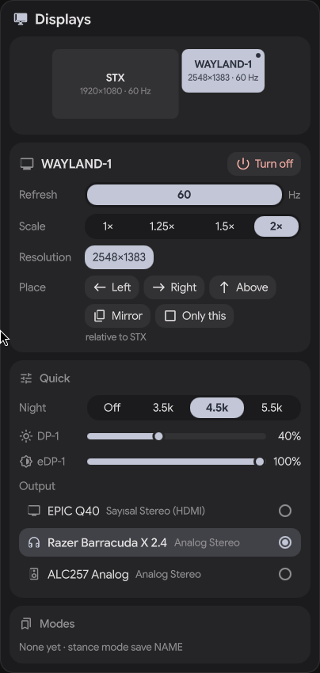
  &nbsp;
  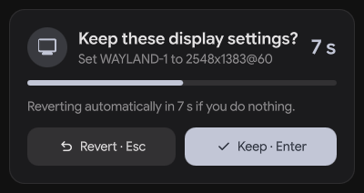
</p>

## Neden

Ekran araçlarının çoğu "uygulamayı aç, ayarla, kapat" mantığında ya da yalnız
arka planda profil değiştirir. stance bar için yapıldı:

- **Bardan iki tık**: canlı yerleşim haritası olan küçük bir panel.
- **Onayla ya da geri dön**: her ekranda 12 sn geri sayım; hiçbir şey yapmazsan
  eski düzen geri gelir. Bar çökse bile çalışır (zamanlayıcıyı ayrık bir bekçi
  süreç tutar).
- **Ekranın ötesinde modlar**: bir mod çalışma alanlarını ekranlara bağlayabilir,
  animasyon / bulanıklık / tearing açıp kapatabilir, boşlukları ve güç
  profilini değiştirebilir. Yalnız beyaz liste: mod dosyası komut çalıştıramaz.
- **Hızlı ayarlar**: gece ışığı (hyprsunset), parlaklık (dizüstü paneli ve
  DDC/CI ile harici ekran) ve ses çıkışı aynı panelde ve modlarda.
- **Tak-çalıştır kuralları** (isteğe bağlı daemon): dock'u tak, masa modun gelsin.
- **Boşta sıfır maliyet**: CLI tık başına çalışıp çıkar (~1 ms, ~1,5 MB);
  isteğe bağlı daemon Hyprland olay soketinde bekler (~3 MB bellek).

## Destek

| | Durum |
|---|---|
| Hyprland | 0.55, 0.56, 0.57 (Lua config ve hyprlang). Daha yenisinde okuma çalışır; ekran değiştirmek test edilene kadar `--force-version` ister |
| Bar / kabuk | end4 / illogical-impulse (hazır düğme + pano rafı), her bar bağımsız panel ile (`stance setup`), Waybar modülü |
| Quickshell | 0.2.x |
| Telefon | Android 8+ ([stance-deck-android](https://github.com/H0dg4m/stance-deck-android)) |
| Diğer masaüstleri (KDE, GNOME, Windows) | 1.0'dan sonra planlı |

stance alfa aşamasında. Bir şey çalışmıyor mu? [docs/troubleshooting.md](docs/troubleshooting.md)
dosyasına bak (her `stance doctor` iletisi için bir madde). Hata bildirirken
`stance doctor --report` çalıştırıp çıkan bloğu yapıştır.

## Kurulum

Arch: `stance-hypr` / `stance-hypr-git` (`packaging/aur` içinde PKGBUILD; AUR yüklemesi bekliyor). Kaynaktan:

```sh
cargo build --release
install -Dm755 target/release/stance ~/.local/bin/stance
stance doctor
```

Hyprland **0.55+** ve Lua config gerekir (0.57 ile test edildi; 0.57 hyprlang
`.conf` desteğini kaldırdı). 0.55/0.56 için `.conf` desteği deneyseldir.
Test edilenden yeni bir Hyprland'de ekranı değiştiren komutlar stance
güncellenene kadar çalışmaz; denemek için `--force-version` (servisler için
`STANCE_FORCE_VERSION=1`).

## Bara ekleme

- **Quickshell** (end-4 / illogical-impulse ve türevleri ya da kendi kabuğun):
  hazır bileşenler, bkz. [docs/quickshell.md](docs/quickshell.md).
- **Waybar**: `stance waybar` bir durum satırı yazar (mod, ekranlar, "koru?"
  geri sayımı); modül ve tıklama eylemleri için [contrib/waybar](contrib/waybar).
  Panel paketteki bağımsız kabuktan gelir.
- **Başka bir bar**: paketteki bağımsız kabuğu bir kez başlat, tıklamaya
  `qs -p /usr/share/stance/quickshell ipc call stance toggle` bağla.
- **Bar yok**: her şey CLI'dan çalışır.

## CLI

```
stance monitors                       ekranları listele
stance set DP-1 --hz 165              bir ekranı değiştir
stance set eDP-1 --off                (son açık ekranı kapatmayı reddeder)
stance layout right-of eDP-1 DP-1     left-of | right-of | above | below | mirror | single
stance arrange DP-1=0x0 eDP-1=2560x360  birden çok ekranı birlikte taşı
stance confirm | stance revert        bekleyen değişikliği koru / geri al
stance persist                        ~/.config/hypr/stance-monitors.lua yaz
stance mode save work                 mevcut düzeni mod olarak kaydet
                                      (--with-quick: gece ışığı + ses çıkışı da)
stance mode apply gaming
stance mode put work --data '{…}'     JSON'dan mod yaz (panel düzenleyicisinin kullandığı)
stance rules | stance rules put --data '{…}'   tak-çalıştır kuralları JSON olarak
stance night on 4500 | off | toggle   hyprsunset ile gece ışığı
stance brightness DP-1 +10            N | +N | -N yüzde (DDC/CI ya da backlight)
stance audio set "Razer"              varsayılan ses çıkışı: id, düğüm adı ya da tekil metin
stance quick                          gece ışığı, parlaklık ve ses tek çağrıda
stance daemon                         tak-çalıştır kuralları (systemd birimi contrib/ içinde)
stance doctor                         yalnız okuyan ortam denetimi
```

`<monitor>` açıklama (`"JDR EPIC Q40"`), `"marka model"` ya da bağlantı adı
olabilir. Değişiklik 12 sn içinde onaylanmazsa geri döner (`--timeout S`,
betikler için `--no-confirm`). Tüm komutlar `--json` ile JSON konuşur.

### Modlar

`~/.config/stance/modes/<ad>.toml`:

```toml
description = "Yalnız harici ekran, efektler kapalı"
power_profile = "performance"           # power-saver | balanced | performance
workspaces = { "1-5" = "JDR EPIC Q40" }
night_light = false                     # true | false | Kelvin cinsinden sıcaklık
audio_sink = "Razer"                    # varsayılan ses çıkışı

[brightness]                            # ekran eşleşmesi = yüzde
"JDR EPIC Q40" = 80

[hyprland]                              # beyaz liste: animations, blur, allow_tearing, gaps_in, gaps_out
animations = false
blur = false
allow_tearing = true

[[monitor]]
match = "JDR EPIC Q40"
mode = "2560x1440@180"
position = "0x0"
vrr = 1

[[monitor]]
match = "AU Optronics 0x7EAD"
enabled = false
```

Modun adını verdiği ama bağlı olmayan ekranlar atlanır; böylece aynı mod dock'ta
da dock'suz da çalışır. Gece ışığı, ses ve parlaklık ekran değişikliğinden sonra
uygulanır, 12 sn geri alma kapsamında değildir (ekranı karartamazlar); biri
başarısız olursa (kulaklık takılı değil, DDC/CI yok) mod yine uygulanır ve not
düşülür. Hyprland ayarları ve güç profiliyle birlikte bunlar "ekstra"dır:
`--no-extras` atlar. Daha fazlası [`examples/`](examples) içinde. Modlar
panelden de eklenip düzenlenir (Ekranlar ve modlar).

### Tak-çalıştır kuralları

`~/.config/stance/rules.toml`: bağlı ekran kümesi kuralın listesine tam eşitse
kural çalışır; hiçbiri eşleşmezse hiçbir şey olmaz.

```toml
[[rule]]
monitors = ["AU Optronics 0x7EAD", "JDR EPIC Q40"]
mode = "desk"
allow_extras = false   # true: modun Hyprland ayarları, güç profili, gece ışığı,
                       # ses ve parlaklığı da uygulanır (son üçü yalnız kural
                       # ekranları gerçekten değiştirdiyse)
```

`systemctl --user enable --now stance.service` ile aç.

### Telefon kumandası

Telefonu Stream Deck benzeri bir kumandaya çevirir: modlar, gece ışığı,
parlaklık, ses çıkışı ve ekran düzeni tuşları; ekran değişikliğinde
Koru / Geri al. Android uygulaması [`android/`](android) içinde (Kotlin,
Compose; QR okuma ZXing ile, Google hizmeti gerekmez; birden çok bilgisayar;
cihaz anahtarı Android Keystore ile sarılır). Kaynaktan derle ya da APK'yı
sürüm sayfasından kur.

<p align="center">
  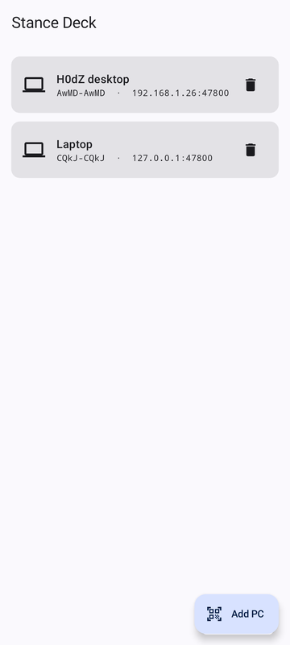
  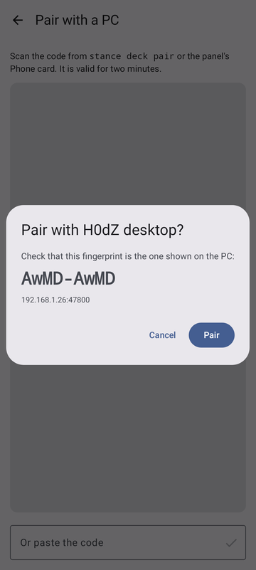
  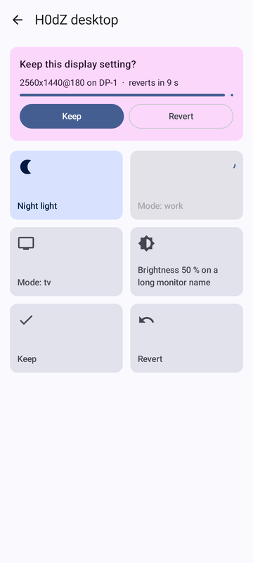
</p>

```sh
stance deck serve            # ya da: systemctl --user enable --now stance-deck.service
stance deck pair             # uygulama için QR (tek telefon, 120 sn)
stance deck devices          # eşli telefonlar; stance deck unpair AD
```

1. Uygulamada **Add PC**'ye dokun, kodu tara (ya da yapıştır), parmak izini
   bilgisayardakiyle karşılaştır, **Pair**'e dokun. Eşleşince bilgisayar bir
   masaüstü bildirimi gösterir.
2. Bir tuşa bas. Ekran değişikliğinde telefonda **Keep / Revert** çıkar; kimse
   yanıt vermezse bilgisayardaki gibi kendiliğinden geri alınır.

Wi-Fi + QR ile eşleştirme ya da USB (`stance deck serve --loopback` ve
`adb reverse tcp:47800 tcp:47800`; kodun adresi `127.0.0.1` olmalı). Bağlantı
şifrelidir (Noise), yalnız eşli telefonlar girer, tuşlar yalnız
`~/.config/stance/deck.toml` içindeki eylemleri çalıştırır; "komut çalıştır"
tuşu yoktur. Güvenlik duvarı kullanıyorsan yerel ağdan TCP 47800'e izin ver
(`stance doctor` söyler).

Tuşları panelde (Ayarlar → Phone buttons) ya da `stance deck buttons`,
`stance deck put --data JSON`, `stance deck reset` ile düzenle.

<p align="center">
  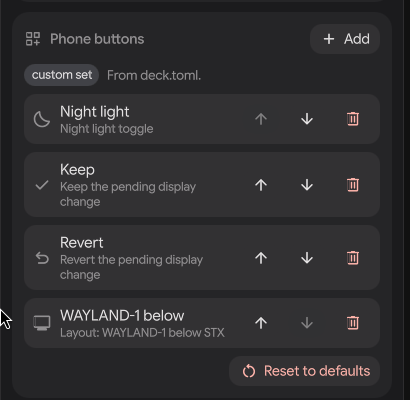
</p>

Ayrıntı ve protokol: [docs/deck.md](docs/deck.md),
[docs/protocol.md](docs/protocol.md); uygulama derleme ve testler:
[android/README.md](android/README.md).

### Ekranlar yerini hatırlar

stance her ekranın son konumunu, modunu ve ölçeğini saklar
(`~/.local/state/stance/memory.json`). Kapatıp açılan ekran eski yerine döner;
daemon çalışıyorsa ve hiçbir kural eşleşmiyorsa çıkarıp yeniden takılan ekran da.
Bir yerleşimin Hyprland yeniden başlayınca da kalması için `stance persist` kullan.

### Dizüstü kapağı ve güç

```lua
-- hyprland.lua: kapak kapanınca dahili ekran kapanır (başka ekran açıksa),
-- açılınca eski yerine döner. Onay sayacı yok: kapak kapalıyken görülmez.
hl.bind("switch:on:Lid Switch", hl.dsp.exec_cmd("stance lid close"), { locked = true })
hl.bind("switch:off:Lid Switch", hl.dsp.exec_cmd("stance lid open"), { locked = true })
```

Tak-çalıştır kuralları güç kaynağına bağlanabilir; daemon açıksa şarj takılıp
çıkarılınca kurallar yeniden değerlendirilir (`stance power` mevcut kaynağı ve
geçerli kuralı gösterir):

```toml
[[rule]]
monitors = ["AU Optronics 0x7EAD"]
mode = "battery-saver"
on_power = "battery"     # ac | battery; eşleşen kural, olmayana göre önceliklidir
```

Waybar için `stance waybar` ve [contrib/waybar](contrib/waybar).

### Kalıcı yapmak

Çalışma anı değişiklikleri bilerek geçicidir (projektör ayarı kalıcı olmasın).
`stance persist` config klasörüne `stance-monitors.lua` yazar; ana config'ine bir
kez `require("stance-monitors")` ekle (nwg-displays kullanıyorsan onun
`require("monitors")` satırından sonra). stance ana config'ine asla dokunmaz.

### Hızlı ayarlar

- **Gece ışığı** hyprsunset soketiyle konuşur. Zaten çalışan bir hyprsunset varsa
  onu kullanır ve senin gamma ayarını korur; "kapalı" nötr 6000 K'dir, sıfırlama
  değil. Hiçbiri çalışmıyorsa `stance night on` bir tane başlatır.
- **Parlaklık**: dizüstü paneli `/sys/class/backlight` ve `brightnessctl` ile,
  harici ekran `ddcutil` ile (`i2c-dev` modülü ve `/dev/i2c-*` erişimi, genelde
  `i2c` grubu gerekir). Ekran tamamen kararmasın diye %5 (backlight) ve %1 (DDC)
  altı yükseltilir.
- **Ses çıkışı** `pw-dump` ile okunur, `wpctl set-default` ile değiştirilir.

Hangilerinin kullanılabildiğini `stance doctor` söyler.

## Temalar ve özellikler

Panelde 17 hazır tema (Catppuccin, Nord, Gruvbox, Dracula, Tokyo Night, Rosé
Pine, Everforest, Kanagawa, One Dark, Solarized, Stance koyu/açık) ve ayrıntılı
bir düzenleyici var; temalar dışa aktarıp paylaşabileceğin düz JSON
dosyalarıdır. Panel İngilizce ve Türkçe konuşur.

<p align="center">
  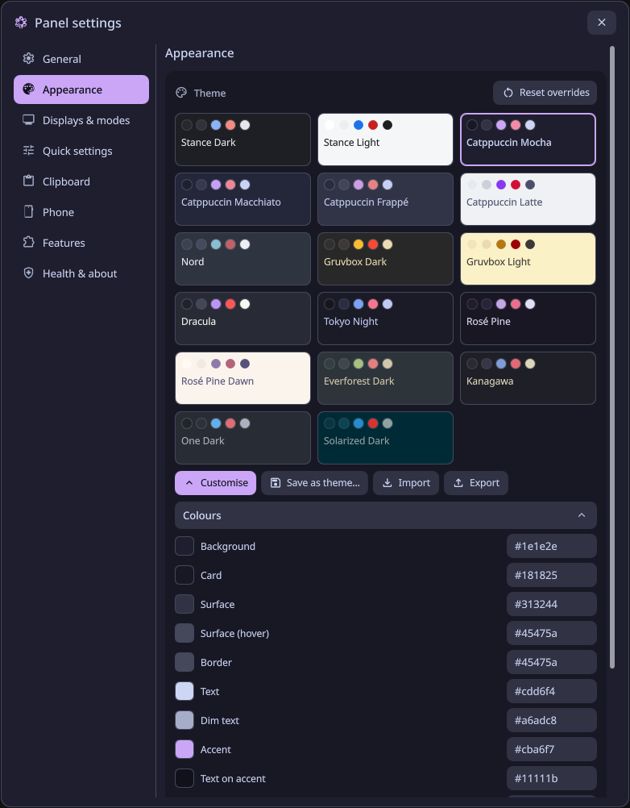
  &nbsp;
  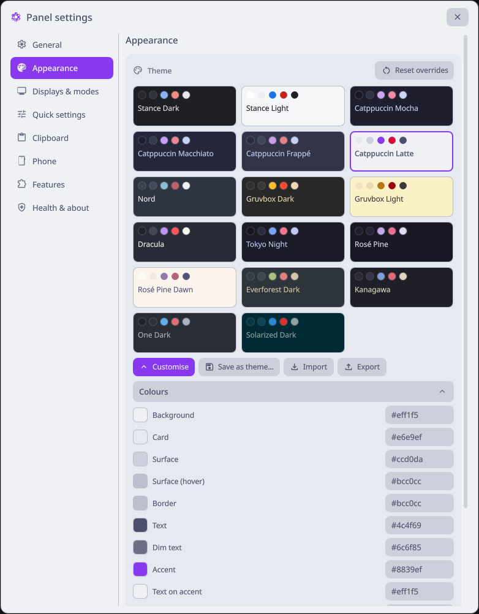
</p>
<p align="center">
  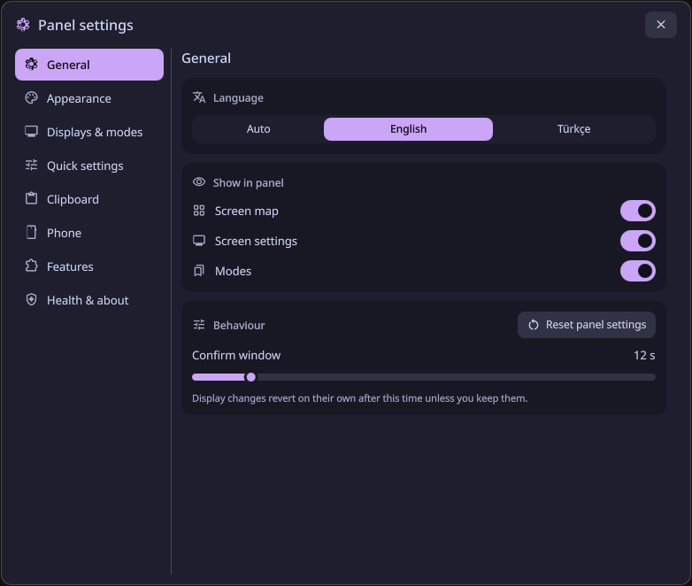
  &nbsp;
  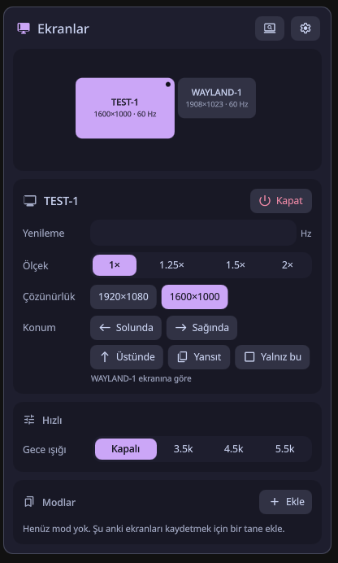
</p>

```sh
stance theme list
stance theme export catppuccin-mocha --out ~/mocha.json
stance theme import ~/arkadas-temasi.json
stance feature off clip          # ayrıca: deck, rules, quick
```
Biçim ve kurallar: [docs/themes.md](docs/themes.md).

## Pano rafı

`stance clip` kopyaladıklarını üç rafta (görseller, metinler, linkler) tutar,
klavyeyle geri seçersin. Sen açana kadar kapalıdır; cliphist'e dokunmadan
onunla yan yana çalışır.

```sh
stance clip config put --data '{"enabled":true,"retention_days":30}'
systemctl --user enable --now stance-clip-text stance-clip-image
stance clip list                 # en yeni üstte, sabitlenenler en başta
stance clip copy 12              # panoya geri koy
stance clip pin 12 ; stance clip rm 13 ; stance clip undo
```

Şifre yöneticisinin "hassas" işaretlediği kopyalar asla saklanmaz (cliphist
çalışıyorsa o yine saklar). Depo yalnız senin kullanıcına açıktır ama
şifrelenmez. Ayrıntı: [docs/clip.md](docs/clip.md).

<p align="center">
  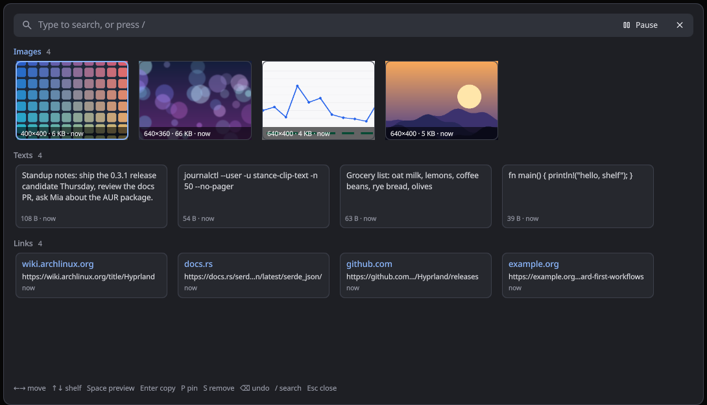
</p>

Şununla aç: `qs -p /usr/share/stance/quickshell ipc call stance clip` (bir tuşa
bağla; bkz. [docs/quickshell.md](docs/quickshell.md)). Oklar gezdirir, Boşluk
önizler, Enter kopyalar, P sabitler, S kaldırır, `/` arar.

## Güvenlik

- Hyprland soketine doğrudan bağlanır; `hyprctl` ve kabuk hiç kullanılmaz.
- Dış araçlar (`ddcutil`, `brightnessctl`, `wpctl`, `pw-dump`, `powerprofilesctl`,
  `hyprsunset`) mutlak yol, argüman listesi, kesin zaman aşımı ve boş stdin ile
  çalışır; çıktıları ayrıştırılır, asla çalıştırılmaz. Parlaklık hedefi ve ses
  çıkışı önce canlı cihaz listesinde çözülür; mod dosyası yalnız gerçek cihazlar
  arasından seçebilir.
- Lua yalnız tipli ve doğrulanmış değerlerden üretilir. EDID metinleri
  compositor'a hiç gitmez, yalnız gösterilir (kontrol karakterleri temizlenir).
- Mod/kural dosyaları: en çok 64 KiB, bilinmeyen alan reddedilir, sahibi sen
  olmalısın ve grup/herkes yazamamalı, komut alanı yoktur.
- Yazmalar atomiktir (`O_EXCL|O_NOFOLLOW` geçici dosya, fsync, rename),
  symlink hedefleri reddedilir. Durum 0700 dizinde tutulur.
- Bekleyen değişiklik Hyprland oturumuna bağlıdır; eski oturumun anlık
  görüntüsü yeni oturuma uygulanmaz. Root gerekmez.

## Geliştirme

```sh
cargo test                    # birim testleri (Noise test vektörleri dahil)
tests/nested.sh lua           # atılabilir iç içe Hyprland'de uçtan uca
cd android && ./gradlew :core:test -Dstance.binary=$PWD/../target/debug/stance
                              # telefon tarafı: vektörler + deck serve ile canlı uyum
```

Yayın adımları: [RELEASE.md](RELEASE.md).

## Lisans

MIT
